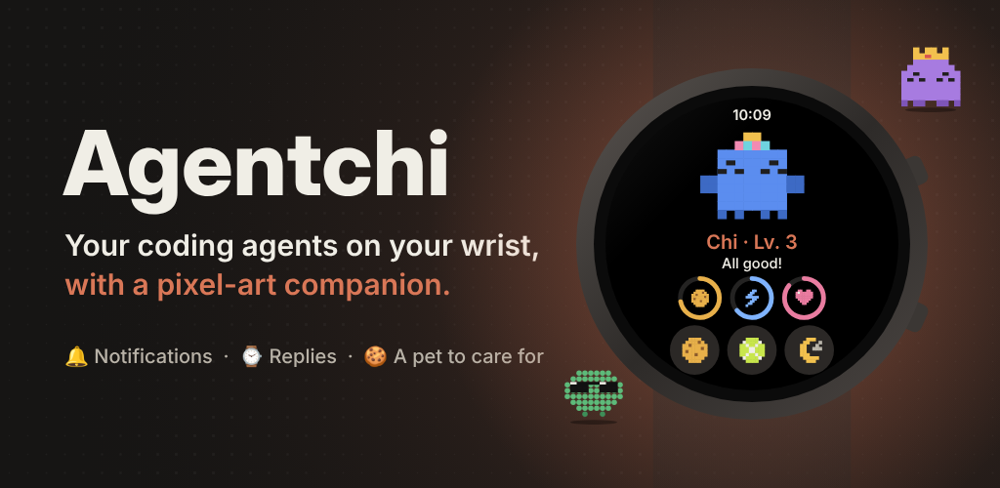
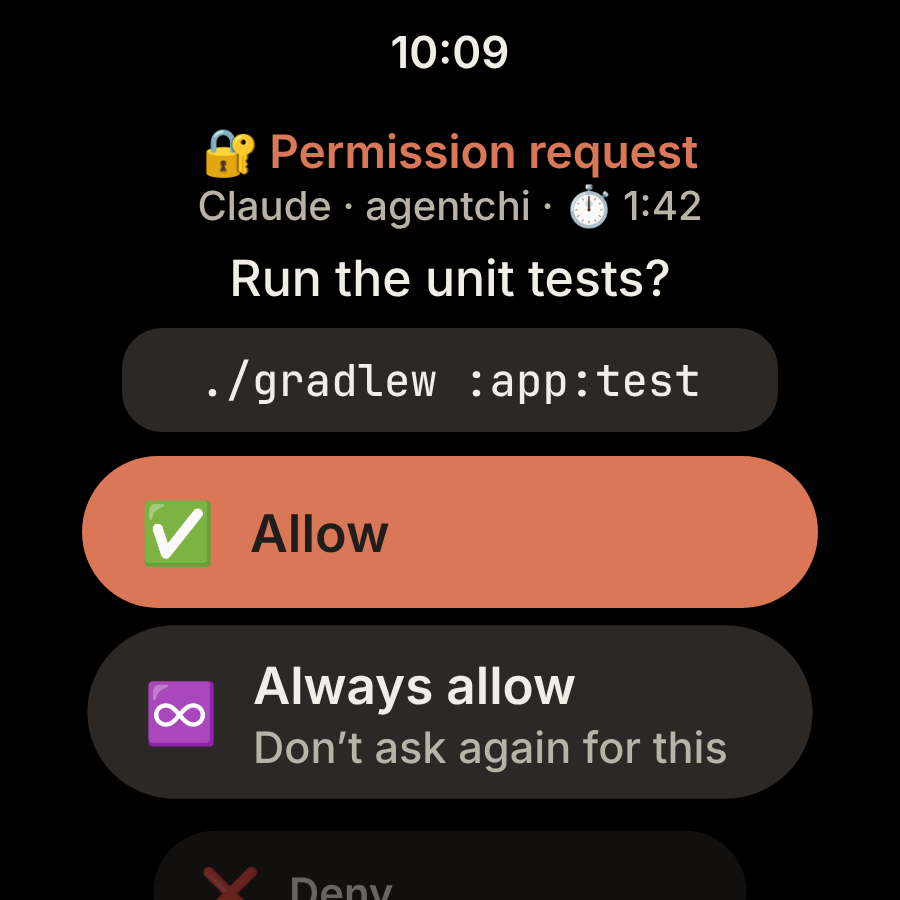
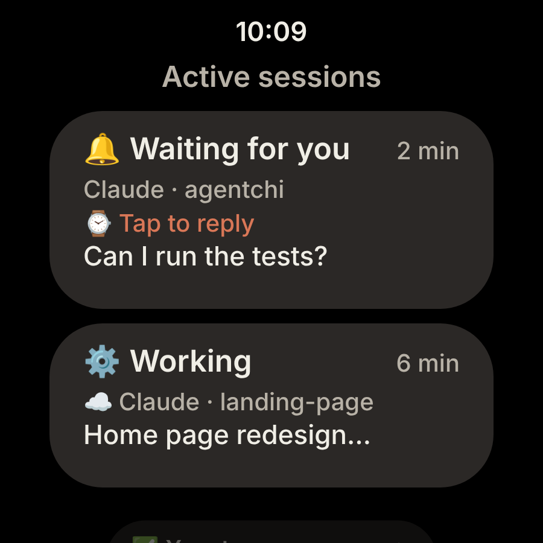
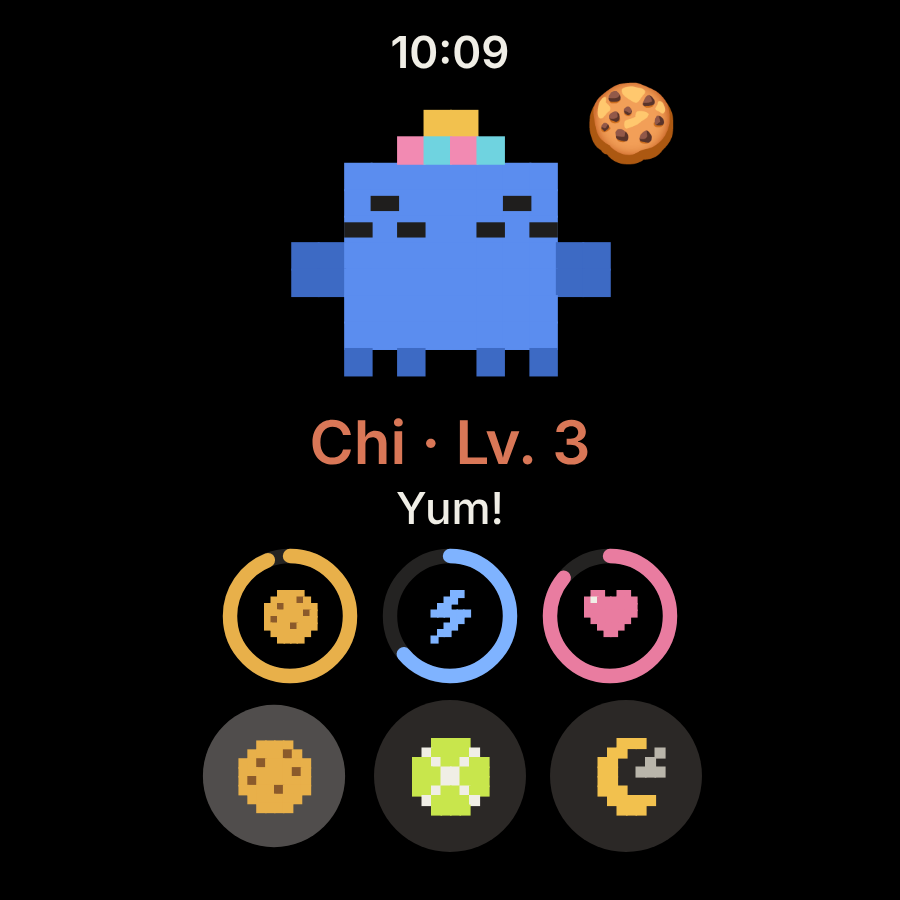
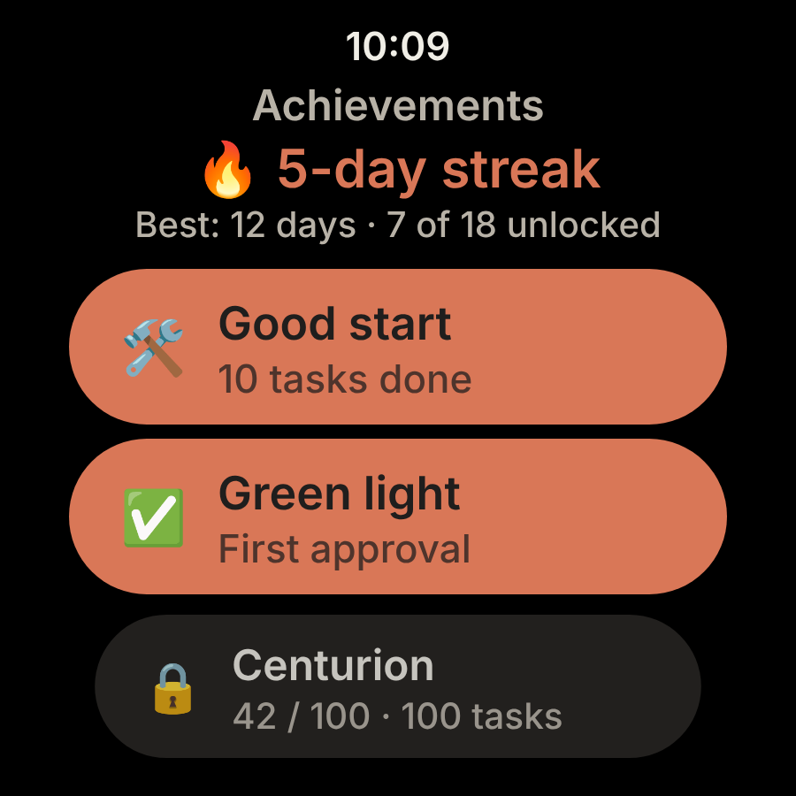

# Agentchi ⌚️

<p align="center"></p>

**Your coding agents on your wrist, with a pixel-art companion.**

Permission requests, questions, finished tasks: it all lands on your **Wear OS** watch and you answer with a tap. Meanwhile Chi, your mascot, lives in sync with your sessions. For **Claude Code** and **Codex**, on watches with Google Play services (Galaxy Watch 4 and newer).

**→ [agentchi.dev](https://agentchi.dev)**: the overview, the video, and ready-to-copy commands.

> Unofficial app, not affiliated with Anthropic or OpenAI. Claude and Claude Code are trademarks of Anthropic; Codex and OpenAI are trademarks of OpenAI.

## A day with your agent

<p align="center">
  
  
  
  
</p>

- 🔐 **It asks for permission**: allow, deny with or without a reason, or pick "always" so you're never bothered about it again. A countdown tells you how long it will wait for you.
- 🧩 **It hesitates, you decide**: tick one or several options of a question, or dictate another answer. A plan to review? Approve it or ask for changes.
- 📋 **You know who's working**: your active sessions at a glance (working, waiting for your answer, done), the ones waiting on you first.
- 🎉 **It celebrates your wins**: task done, Chi throws a party and earns experience. You can reply with the keyboard, by voice or with a quick reply.
- 🍪 **And it gets hungry**: fullness, energy and happiness drop over time. Feed it, play with it, give it a cuddle, clean up its poops. It panics when your agent needs you.
- 🔥 **Your streaks count**: days in a row with finished tasks, answers given from the watch, achievements that unlock as your sessions go by.
- 🌙 **It respects your nights**: quiet hours, *Do not disturb* and Bedtime mode. Non-urgent events are bundled into a single summary, only urgent ones get through.

**Make it your own**: 3 species, 6 colors, 5 accessories, which follow your mascot onto the tile, the complication, the Agentchi watch face and even the app icon. Your agents' Markdown stays readable on the round screen, alerts are configurable (full screen, silent, vibration, sound), and there's **no app to install on your phone**.

## How it works

```
Claude Code (computer, Remote Control) ──agentchi plugin──────────┐
claude.ai/code cloud session ───────────repo http hook────────────┼──HTTPS──▶ agentchi.dev ──FCM──▶ your watch
Codex (CLI, app, IDE) ──────────────────~/.codex/hooks.json───────┘
```

Your agents send their events through their **hooks** to the Agentchi server, which pushes them right away to your watch via Firebase Cloud Messaging. The server is open source: you can use **agentchi.dev** or [host your own](docs/self-hosted/README.md).

- **Nothing piles up**: events go straight to the right watch without being kept; the server only stores registered watches and a hash of their codes.
- **One code per computer**: each computer or cloud environment is paired with its own code (`XXXX-XXXX-XXXX`), created on the watch and revocable from it.
- **No account, no ads**: each watch registers itself and only receives its own events.

| Where the agent runs | How the watch is notified |
|---|---|
| Claude Code: terminal, IDE, Desktop app | `agentchi` plugin |
| Claude Code in **Remote Control** (claude.ai/code, mobile app) | Plugin: the session runs on your computer |
| **Cloud session** on claude.ai/code | `http` hook in the repo's `.claude/settings.json`: cloud sessions don't load plugins |
| **Codex**: CLI, app, IDE extension (macOS, Linux, WSL) | Codex hooks (`~/.codex/hooks.json` or the `agentchi-codex` plugin) |
| claude.ai chat, ChatGPT | Not supported: no hooks |

## Install Agentchi

> The watch app is in English, or in French when the watch is set to French (Wear OS 4+ also lets you pick the app's language in the system settings).

### 1. The app on your watch

Agentchi will install from the **Google Play Store**, right on your Wear OS watch: the listing is coming soon. Until then, the CI build of the APK installs with `adb` (see [the self-hosting guide](docs/self-hosted/README.md#3-the-watch)).

Open **Agentchi**, allow notifications, then go to **Settings › Server**: enter `https://agentchi.dev` and tap **Connect the watch**.

### 2. One code per computer

On the watch: **Settings › Server › New code**, name the computer and write down the `XXXX-XXXX-XXXX` code. Plan one code per computer or cloud environment: each one can be revoked separately.

### 3. Hook up your agents

#### Claude Code (terminal, IDE, Desktop app, Remote Control)

A single command, with your code:

```bash
claude plugin install agentchi --marketplace Pelagoss/agentchi \
  --config server_url=https://agentchi.dev --config code=XXXX-XXXX-XXXX
```

That's it, for all your projects. The code is stored in the system keychain, not in `settings.json`. Without `--config`, Claude Code prompts for both values (`/plugin` › agentchi › *Configure options*). Requires `curl`, available by default on macOS, Linux and Windows 10+. The plugin also covers local sessions you follow in **Remote Control** from claude.ai/code or the mobile app.

You can also add the `Pelagoss/agentchi` marketplace in **claude.ai › Customize › Plugins**: the plugin then syncs to every computer where you sign in to Claude Code. All that's left is entering the code.

#### Claude cloud sessions (claude.ai/code)

Cloud sessions don't load plugins, but they do run the repo's hooks:

1. Add to the repo's `.claude/settings.json` the block served by [`https://agentchi.dev/v1/cloud-settings.json`](https://agentchi.dev/v1/cloud-settings.json). It's an `http` hook that sends `Authorization: Bearer $AGENTCHI_CODE`.
2. On the watch, create a code for this cloud environment.
3. In the cloud environment settings on claude.ai/code:
   - environment variable `AGENTCHI_CODE=XXXX-XXXX-XXXX`;
   - **custom** network access that allows `agentchi.dev`.

Everyone working on the repo puts **their own code** in **their** environment. Without a code, the hook does nothing and shows no error. On a computer, the variable isn't set, so there are no duplicates with the plugin.

#### Codex (CLI, app, IDE; macOS, Linux, WSL)

Register the Codex hooks and make your code visible to Codex:

```bash
curl -fsS https://agentchi.dev/v1/codex-hooks.json -o ~/.codex/hooks.json
echo 'export AGENTCHI_CODE=XXXX-XXXX-XXXX' >> ~/.zshrc   # or ~/.bashrc
```

If you already have a `~/.codex/hooks.json`, merge the two instead of overwriting it. Codex ignores a hook until you've approved it: run **`/hooks`** in Codex and approve Agentchi's.

In the Codex app (desktop), you can also install the `agentchi-codex` plugin: `codex plugin marketplace add Pelagoss/agentchi`, then install it from the plugin directory. It reads the code from `AGENTCHI_CODE` and the address from `AGENTCHI_SERVER` (default `https://agentchi.dev`).

With Codex, the watch receives task completions and permission requests (commands, file edits, MCP tools) and can answer them. Its multiple-choice questions (`request_user_input`) stay on the computer: Codex doesn't pass them to hooks. In *Active sessions*, a Codex session doesn't switch back to "working" when you write to it: its hooks don't relay sent messages.

### 4. Check, then step away

**Settings › Server › Test push**: the server sends a notification through FCM and shows the error on the watch if it doesn't go through. Firebase holds a push for 24 h if the watch is off or offline. Then turn on **Settings › Replies › Reply from the watch** when you leave your screen.

## Replying from the watch

On the watch: **Settings › Replies › Reply from the watch**. Turn it on when you step away from your screen, and off when you come back.

| When the agent… | Hook | On the watch |
|---|---|---|
| asks for permission ("1. Yes / 2. Yes, don't ask again / 3. No") | `PermissionRequest` | ✅ Allow, ♾️ Always allow (Claude Code), ❌ Deny, with or without a reason |
| asks a multiple-choice question (Claude Code: `AskUserQuestion`, checkboxes included) | `PreToolUse` | Options to tick, one or several, or ✍️ another answer |
| proposes a plan (Claude Code: `ExitPlanMode`) | `PreToolUse` | ✅ Approve, ✍️ Ask for changes |
| is done and waiting for your reply | `Stop` | 💬 Keyboard, voice or quick reply ("Continue"…), or 🏁 Finish |

Simple answers can be given from the notification. Tap it for the full screen: whole text, multiple choices, countdown. The **tile** and the **complication** also flag a pending question and take you there with a tap. The **history** keeps what you answered under each question.

Every answer given from the watch counts toward [achievements](#streaks-and-achievements).

The hook waits for your answer **1, 2 or 5 minutes** depending on the *Wait for my reply* setting (2 by default). **Quick replies** can be edited in *Replies › Quick replies*. Once the delay is up, or if you **swipe the notification away**, the agent asks the question on screen as usual. With the setting off, the server hands control back right away: nothing changes on the computer, and task completion stays a plain notification.

## Notifications

**Settings › Notifications**:

- **Notify me when…**: the events you want to receive, urgent (permission, reply expected, error) or not.
- **Alert styles**: full screen, notification or silent, and vibration pattern, separately for urgent events and the rest.
- **Grouped summary** (on by default): non-urgent events stack into a single notification, "✅ 3 tasks done · 1 session ended — across 2 projects", with the latest lines in detail. Only the first one vibrates; tap the summary to open the history. It starts over when you swipe it away. Urgent events and questions to answer stay separate.
- **Follow the watch** (on by default): when *Do not disturb* or *Bedtime mode* is on, Agentchi notifications go silent and stop vibrating, just like during **quiet hours** (configurable time range). *Let urgent events through* applies to both.

## Active sessions

From the mascot screen, **Active sessions** lists your agents' sessions, the ones waiting on you first:

| State | When |
|---|---|
| ⚙️ Working | you just wrote to the agent, or it's making progress (subagent, compaction), or you answered from the watch |
| 🔔 Waiting for you | permission request, question, reply expected |
| ✅ Your turn | task done, or session started |
| ⚠️ Error | API error |

Tapping a session opens the pending question, or the cloud session on the phone. A session disappears when it closes (`SessionEnd`), or after 12 h without news. The watch receives all these events, even the ones you don't want as notifications: only those ticked in *Notify me when…* are shown.

"Working" comes from the `UserPromptSubmit` hook (Claude Code plugin and cloud sessions): it tells the server when you write to the agent, without forwarding your message to the watch. These pushes go out at normal priority (they don't wake the watch) and without an ID, so that earlier versions of the app ignore them.

## The mascot

| Gauge | Drops | Goes up |
|---|---|---|
| 🍪 Fullness | −6 / h | Feed (+25) |
| ⚡ Energy | −5 / h | Sleep (+15 / h) |
| 💖 Happiness | −4 / h, −2 / h more per poop | Play (+20), pet it (tap), clean (+5 per poop), every task an agent finishes (+10) |

Every now and then (every 3 h, half as fast while asleep, sooner after a meal), the mascot **poops** 💩 next to itself, up to three times. Poops drag its mood down, and from two on it sulks (🤢 "Something stinks in here…"): the **Clean** button appears under the actions to tidy up, even while it sleeps (+1 XP per poop).

Every finished task also earns XP (+10). The mascot levels up every 100 XP.

**Settings › Mascot**, with a live preview:

- **Name**, and **species**: Crab, Dots (a cloud of dots) or Ghost;
- **Colors**: Coral, Ink, Ocean, Mint, Lilac, Rose;
- **Accessory**: party hat, bow, sunglasses (level 2), top hat (level 3), crown (level 5);
- **Action icons**: pixel art matching the mascot, or emoji;
- **App icon**: classic, or matching the mascot (species and colors). The launcher updates it within a few seconds.

All the drawing comes from `MascotSprite` (pixel-art grid): the app, the tile and the app icons (generated by `AppIconsTest`) always stay in agreement.

- **Tile** (swipe the watch face, then *+* › Agentchi): the mascot, its mood and its gauges. When an agent is waiting for an answer, the tile shows the question with a **Reply** button.
- **Complication** *Agentchi mascot* (long-press the watch face › Edit): the mascot's average shape as a gauge or short text, 🔔 when an agent is waiting, or the mascot itself as an image.
- **Agentchi watch face** (`agentchi-cadran.apk`, Wear OS 4 or newer): the time, the mascot large in the center and its shape at the bottom. It's built with [Watch Face Format](https://developer.android.com/training/wearables/wff): the mascot comes from the app's complication, so it follows its mood and panics when an agent is waiting. Pick it by long-pressing your current watch face. If the mascot doesn't show up, go to *Customize* › *Mascot* slot › *Agentchi mascot*. In ambient mode (always-on display), only the time remains.

### Streaks and achievements

From the mascot screen, **Achievements** shows your current **streak** (days in a row with at least one finished task, and your record), then the achievements, unlocked or not, with their progress. Unlocking one sends a notification and the mascot throws a party.

| | Achievement | How |
|---|---|---|
| 🎉 🛠️ 🏗️ 🚀 | First success, Good start, Centurion, Code factory | 1, 10, 100 and 1,000 tasks done |
| 🔥 📅 🗓️ | Three days, one week, one month in a row | Streak of 3, 7 and 30 days |
| ✅ 🛂 | Green light, Customs officer | 1 and 100 permissions granted from the watch |
| 🛑 | Guardrail | First denial from the watch |
| 🗣️ 💬 | First words, Chatterbox | 1 and 50 messages sent from the watch (keyboard or voice) |
| 🗺️ 🧩 | Architect, Decision-maker | First plan approved, first multiple-choice question answered |
| 🦉 | Night owl | A task done between midnight and 5 am |
| 🍪 | Pampered | Feed the mascot 50 times |
| 🧽 | Spring cleaning | Clean up 30 poops |
| 👑 🌟 | Level 5, Level 10 | Mascot levels |

## Privacy

- **Server**: agentchi.dev, or [your own](docs/self-hosted/README.md). It receives events over HTTPS (folder name, short session ID, first 300 characters of the agent's last message) and forwards them right away to Firebase, without storing them. The `UserPromptSubmit` hook also sends it your message to the agent: it keeps nothing and doesn't forward it to the watch, only the fact that a message was sent. Hooks send plain JSON: there's no end-to-end encryption, trust rests on the server and on Firebase Cloud Messaging (Google), which delivers the push.
- **Replies**: a pending question only lives in memory, for as long as it takes to answer. Only the watch that received it can answer it, and only once. A watch that can reply can approve commands: turn the setting off if you lend it to someone.
- **Codes and tokens**: the server only keeps their SHA-256 hash. Each watch only reads its own events. Attempts with an invalid code are rate-limited.

Full policy: [docs/PRIVACY.md](docs/PRIVACY.md) ([en français](docs/PRIVACY.fr.md)).

## Development

- Watch: Kotlin, Jetpack Compose (Wear OS Material), ProtoLayout tiles, complications, Firebase Cloud Messaging, DataStore, OkHttp
- Server: Go, standard library only
- `./gradlew :app:testDebugUnitTest`: mascot and sprites, up-to-date app icons, push parsing, filters, Markdown, grouped summary, active sessions, streaks and achievements
- `./gradlew :watchface:assembleDebug`: the watch face. Its `watchface.xml` follows the [Watch Face Format](https://github.com/google/watchface) schema version 1 (XSD 1.1, validate with Xerces: xmllint can't read this schema)
- `cd server && go test ./...`: hook translation (Claude Code, Codex), replies from the watch, pairing, isolation between watches, FCM sending (JWT, OAuth, expired token), persistence, up-to-date Codex plugin, home page (install info, language routing, SEO tags, robots.txt and sitemap, static files, mascot scripts in sync with `Stores/source`)
- `claude plugin validate .`: Claude Code marketplace and plugin
- Generated files: `UPDATE_CODEX_HOOKS=1 go test -run TestPluginCodex` (in `server/`) and `UPDATE_APP_ICONS=1 ./gradlew :app:testDebugUnitTest --tests '*AppIconsTest*'`
- Store visuals and video, in French and English: `node Stores/source/render-assets.mjs` and `node Stores/source/render-video.mjs [fr|en]` (Playwright, plus ffmpeg and python3 for the video)

```
app/              Wear OS app: push/ (FCM), net/ (server API), notify/, pet/ (logic, sprites, achievements), sync/, text/, ui/, widget/ (tile, complication, icons)
watchface/        Watch Face Format watch face (resources only, no code)
server/           Go server: hooks → FCM, replies, pairing API, home page in English and French (web/), Docker + Caddy
Stores/           store listings, visuals and video (French, English in assets/en/), and their sources (source/)
docs/             Play Store publishing, privacy policy, self-hosted server (self-hosted/)
plugins/          Claude Code plugin agentchi (.claude-plugin/marketplace.json) and Codex plugin agentchi-codex (.agents/plugins/marketplace.json)
keystore/         debug key (same signature from one build to the next)
```

## Host your own server

Your Firebase project, your server (Kubernetes, Docker Compose or a plain Go binary), a watch build pointed at it and installing the APK with `adb`: it's all in **[docs/self-hosted/README.md](docs/self-hosted/README.md)**.
