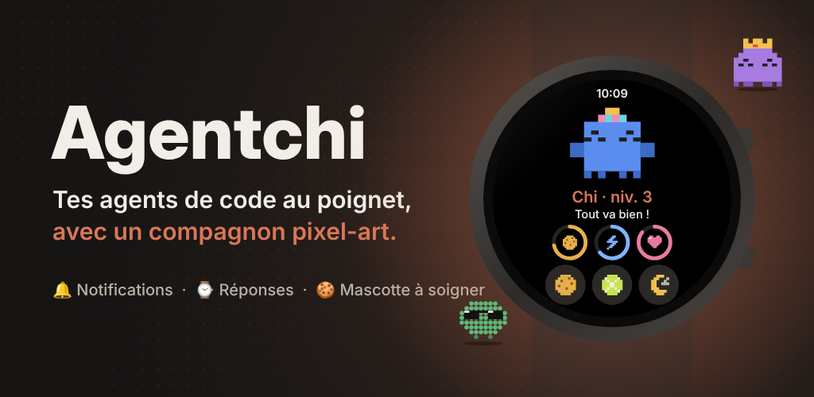
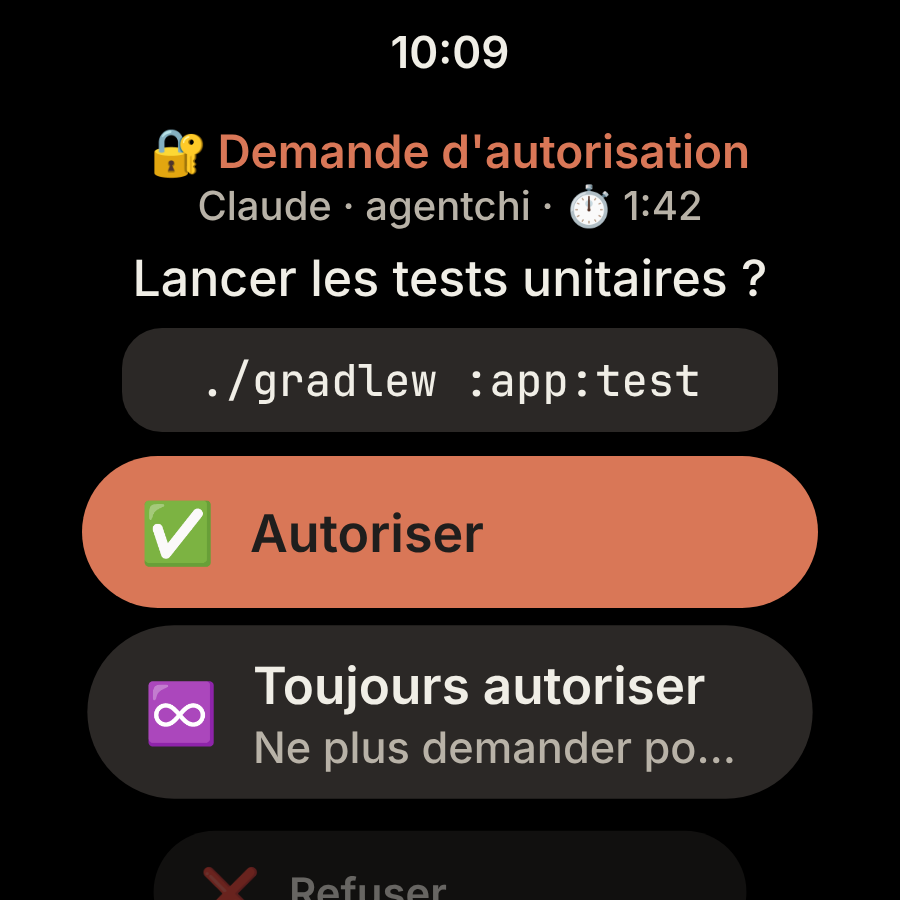
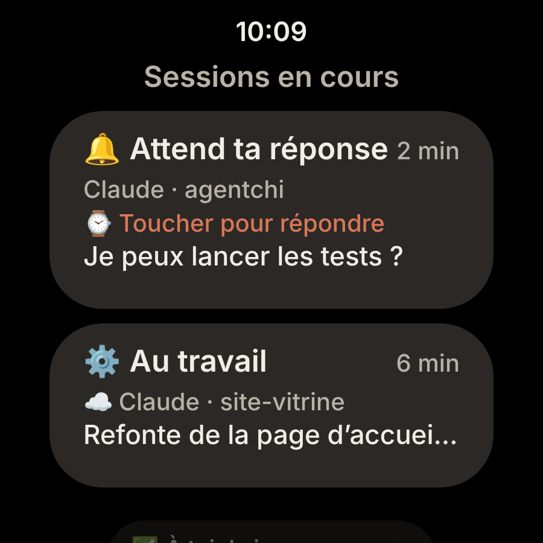
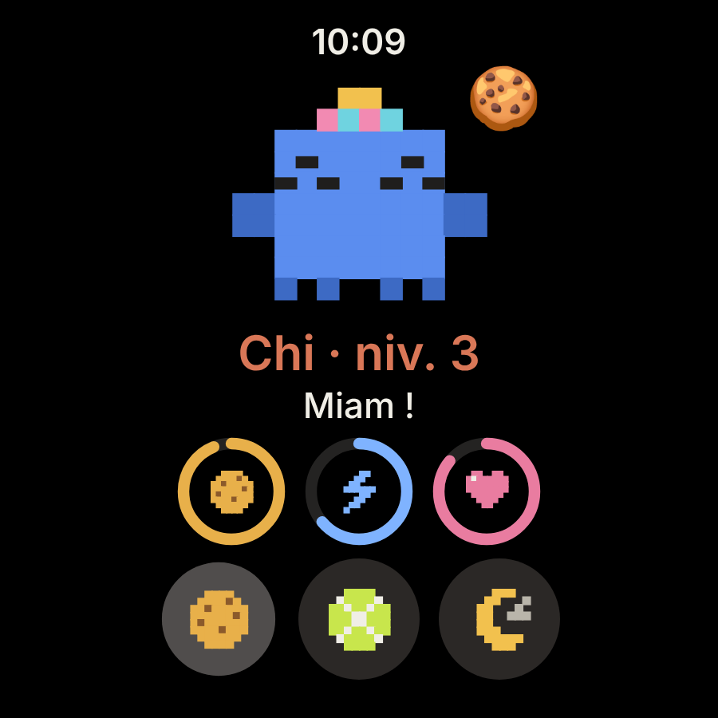
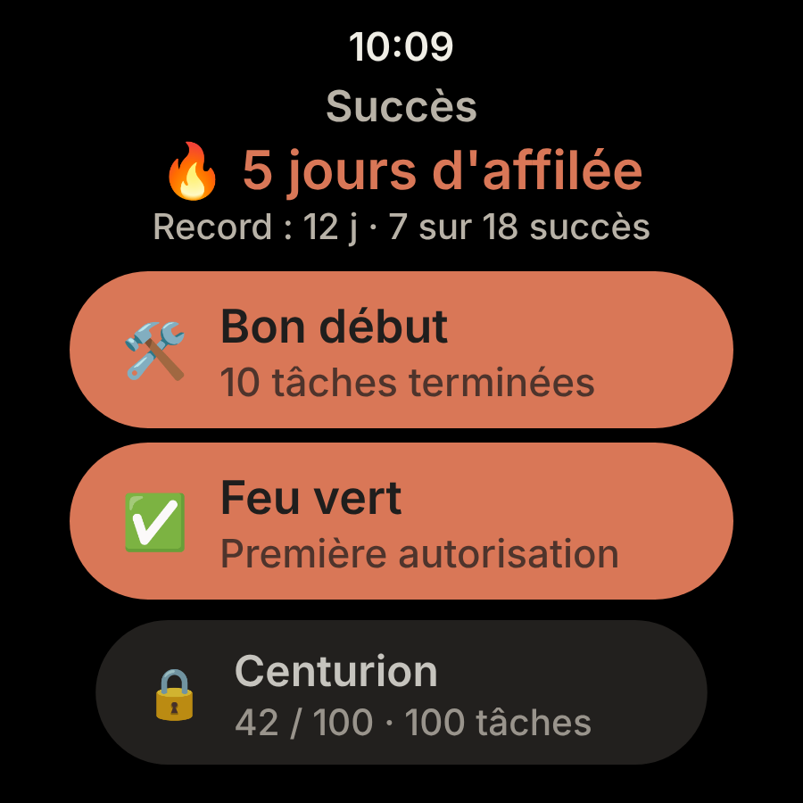

# Agentchi ⌚️

<p align="center"></p>

**Tes agents de code au poignet, avec un compagnon pixel-art.**

Demande d'autorisation, question, tâche terminée : tout arrive sur ta montre **Wear OS** et tu réponds d'un geste. Pendant ce temps, Chi, ta mascotte, vit au rythme de tes sessions. Pour **Claude Code** et **Codex**, sur les montres avec les services Google Play (Galaxy Watch 4 et plus récentes).

**→ [agentchi.dev](https://agentchi.dev)** : la présentation, la vidéo, et les commandes prêtes à copier.

> Application non officielle, sans lien avec Anthropic ni OpenAI. Claude et Claude Code sont des marques d'Anthropic ; Codex et OpenAI sont des marques d'OpenAI.

## Une journée avec ton agent

<p align="center">
  
  
  
  
</p>

- 🔐 **Il te demande la permission** : autorise, refuse avec ou sans explication, ou choisis « toujours » pour ne plus être dérangé pour ça. Un compte à rebours te dit combien de temps il t'attend.
- 🧩 **Il hésite, tu choisis** : coche une ou plusieurs options d'une question, ou dicte une autre réponse. Un plan à valider ? Approuve-le ou demande des changements.
- 📋 **Tu sais qui travaille** : les sessions en cours d'un coup d'œil (au travail, en attente de ta réponse, terminées), celles qui t'attendent en premier.
- 🎉 **Il fête tes victoires** : tâche terminée, Chi fait la fête et gagne de l'expérience. Tu peux répondre au clavier, à la voix ou d'une réponse rapide.
- 🍪 **Et il a faim** : satiété, énergie, bonheur baissent avec le temps. Nourris-le, joue avec lui, fais-lui un câlin, nettoie ses cacas. Il s'affole quand ton agent a besoin de toi.
- 🔥 **Tes séries comptent** : jours d'affilée avec des tâches terminées, réponses données depuis la montre, les succès se débloquent au fil des sessions.
- 🌙 **Il respecte tes nuits** : heures calmes, *Ne pas déranger* et mode Coucher. Les événements non urgents se regroupent en un seul résumé, seules les urgences passent.

**Fais-le à ton image** : 3 espèces, 6 couleurs, 5 accessoires, qui suivent ta mascotte sur la tuile, la complication, le cadran Agentchi et même l'icône de l'appli. Le Markdown des agents reste lisible sur l'écran rond, les alertes se règlent (plein écran, discrète, vibration, son), et il n'y a **aucune appli à installer sur le téléphone**.

## Comment ça marche

```
Claude Code (ordinateur, Remote Control) ──plugin agentchi──────────┐
Session cloud claude.ai/code ─────────────hook http du dépôt────────┼──HTTPS──▶ agentchi.dev ──FCM──▶ ta montre
Codex (CLI, appli, IDE) ──────────────────~/.codex/hooks.json───────┘
```

Tes agents envoient leurs événements par leurs **hooks** au serveur Agentchi, qui les pousse aussitôt à ta montre par Firebase Cloud Messaging. Le serveur est open source : tu peux utiliser **agentchi.dev** ou [héberger le tien](docs/self-hosted/README.md).

- **Rien ne s'accumule** : les événements filent vers la bonne montre sans être conservés ; le serveur ne garde que les montres enregistrées et l'empreinte de leurs codes.
- **Un code par ordinateur** : chaque ordinateur ou environnement cloud est appairé avec son propre code (`XXXX-XXXX-XXXX`), créé sur la montre et révocable depuis elle.
- **Pas de compte, pas de publicité** : chaque montre s'enregistre toute seule et ne reçoit que ses événements.

| Où tourne l'agent | Comment la montre est prévenue |
|---|---|
| Claude Code : terminal, IDE, appli Desktop | Plugin `agentchi` |
| Claude Code en **Remote Control** (claude.ai/code, appli mobile) | Plugin : la session tourne sur ton ordinateur |
| **Session cloud** claude.ai/code | Hook `http` dans le `.claude/settings.json` du dépôt : les sessions cloud ne chargent pas les plugins |
| **Codex** : CLI, appli, extension IDE (macOS, Linux, WSL) | Hooks Codex (`~/.codex/hooks.json` ou plugin `agentchi-codex`) |
| Chat claude.ai, ChatGPT | Non pris en charge : pas de hooks |

## Installer Agentchi

### 1. L'appli sur ta montre

Agentchi s'installera depuis le **Google Play Store**, directement sur ta montre Wear OS : la fiche arrive bientôt. En attendant, l'APK de la CI s'installe par `adb` (voir [le guide auto-hébergé](docs/self-hosted/README.md#3-la-montre)).

Ouvre **Agentchi**, accepte les notifications, puis **Paramètres › Serveur** : saisis `https://agentchi.dev` et touche **Connecter la montre**.

### 2. Un code par ordinateur

Sur la montre : **Paramètres › Serveur › Nouveau code**, nomme l'ordinateur et note le code `XXXX-XXXX-XXXX`. Prévois un code par ordinateur ou par environnement cloud : chacun se révoque séparément.

### 3. Branche tes agents

#### Claude Code (terminal, IDE, appli Desktop, Remote Control)

Une seule commande, avec ton code :

```bash
claude plugin install agentchi --marketplace Pelagoss/agentchi \
  --config server_url=https://agentchi.dev --config code=XXXX-XXXX-XXXX
```

C'est tout, pour tous tes projets. Le code est rangé dans le trousseau du système, pas dans `settings.json`. Sans `--config`, Claude Code demande les deux valeurs (`/plugin` › agentchi › *Configure options*). Il faut `curl`, présent par défaut sur macOS, Linux et Windows 10+. Le plugin couvre aussi les sessions locales que tu suis en **Remote Control** depuis claude.ai/code ou l'appli mobile.

Tu peux aussi ajouter la marketplace `Pelagoss/agentchi` dans **claude.ai › Personnaliser › Plugins** : le plugin se synchronise alors sur chaque ordinateur où tu te connectes à Claude Code. Il ne reste qu'à saisir le code.

#### Sessions cloud Claude (claude.ai/code)

Les sessions cloud ne chargent pas les plugins, mais elles exécutent les hooks du dépôt :

1. Ajoute à `.claude/settings.json` du dépôt le bloc que donne [`https://agentchi.dev/v1/cloud-settings.json`](https://agentchi.dev/v1/cloud-settings.json). C'est un hook `http` qui envoie `Authorization: Bearer $AGENTCHI_CODE`.
2. Sur la montre, crée un code pour cet environnement cloud.
3. Dans les paramètres de l'environnement cloud sur claude.ai/code :
   - variable d'environnement `AGENTCHI_CODE=XXXX-XXXX-XXXX` ;
   - accès réseau **personnalisé** qui autorise `agentchi.dev`.

Chaque personne qui travaille sur le dépôt met **son propre code** dans **son** environnement. Sans code, le hook ne fait rien et n'affiche pas d'erreur. Sur un ordinateur, la variable n'est pas définie, donc pas de doublon avec le plugin.

#### Codex (CLI, appli, IDE ; macOS, Linux, WSL)

Enregistre les hooks Codex et rends ton code visible de Codex :

```bash
curl -fsS https://agentchi.dev/v1/codex-hooks.json -o ~/.codex/hooks.json
echo 'export AGENTCHI_CODE=XXXX-XXXX-XXXX' >> ~/.zshrc   # ou ~/.bashrc
```

Si tu as déjà un `~/.codex/hooks.json`, fusionne les deux plutôt que de l'écraser. Codex ignore un hook tant que tu ne l'as pas approuvé : lance **`/hooks`** dans Codex et approuve ceux d'Agentchi.

Dans l'appli Codex (desktop), tu peux aussi installer le plugin `agentchi-codex` : `codex plugin marketplace add Pelagoss/agentchi`, puis l'installer depuis le répertoire des plugins. Il lit le code dans `AGENTCHI_CODE` et l'adresse dans `AGENTCHI_SERVER` (défaut `https://agentchi.dev`).

Avec Codex, la montre reçoit les fins de tâche, les demandes d'autorisation (commandes, modifications de fichiers, outils MCP) et peut y répondre. Ses questions à choix (`request_user_input`) restent sur l'ordinateur : Codex ne les passe pas aux hooks. Dans *Sessions en cours*, une session Codex ne repasse pas « au travail » quand tu lui écris : ses hooks ne relaient pas l'envoi d'un message.

### 4. Vérifie, puis éloigne-toi

**Paramètres › Serveur › Tester le push** : le serveur envoie une notification par FCM et affiche l'erreur sur la montre si elle ne part pas. Firebase garde un push 24 h si la montre est éteinte ou hors ligne. Puis active **Paramètres › Réponses › Répondre depuis la montre** quand tu quittes ton écran.

## Répondre depuis la montre

Sur la montre : **Paramètres › Réponses › Répondre depuis la montre**. Active-le quand tu t'éloignes de l'écran, et désactive-le quand tu y reviens.

| Quand l'agent… | Hook | Sur la montre |
|---|---|---|
| demande une autorisation (« 1. Oui / 2. Oui, ne plus demander / 3. Non ») | `PermissionRequest` | ✅ Autoriser, ♾️ Toujours autoriser (Claude Code), ❌ Refuser, avec ou sans explication |
| pose une question à choix (Claude Code : `AskUserQuestion`, cases à cocher comprises) | `PreToolUse` | Options à cocher, une ou plusieurs, ou ✍️ autre réponse |
| propose un plan (Claude Code : `ExitPlanMode`) | `PreToolUse` | ✅ Approuver, ✍️ Demander des changements |
| a fini et attend ta réponse | `Stop` | 💬 Réponse au clavier, à la voix ou rapide (« Continue »…), ou 🏁 Terminer |

Les réponses simples se donnent depuis la notification. Touche-la pour l'écran complet : texte entier, choix multiples, compte à rebours. La **tuile** et la **complication** signalent aussi une question en attente et y mènent d'un toucher. L'**historique** garde ce que tu as répondu sous chaque question.

Chaque réponse donnée depuis la montre compte pour les [succès](#séries-et-succès).

Le hook attend ta réponse **1, 2 ou 5 minutes** selon le réglage *Attendre ma réponse* (2 par défaut). Les **réponses rapides** se modifient dans *Réponses › Réponses rapides*. Passé le délai, ou si tu **balaies la notification**, l'agent pose la question à l'écran comme d'habitude. Réglage désactivé, le serveur rend la main tout de suite : rien ne change sur l'ordinateur, la fin de tâche reste une simple notification.

## Notifications

**Paramètres › Notifications** :

- **Me notifier quand…** : les événements à recevoir, urgents (autorisation, réponse attendue, erreur) ou non.
- **Styles des alertes** : plein écran, notification ou discrète, et motif de vibration, séparément pour les urgences et le reste.
- **Résumé groupé** (activé par défaut) : les événements non urgents s'ajoutent à une seule notification, « ✅ 3 tâches terminées · 1 session terminée — sur 2 projets », avec les dernières lignes en détail. Seule la première vibre ; touche le résumé pour ouvrir l'historique. Il repart de zéro quand tu le balaies. Les urgences et les questions auxquelles répondre restent à part.
- **Suivre la montre** (activé par défaut) : quand *Ne pas déranger* ou le *mode Coucher* est actif, les notifications d'Agentchi deviennent discrètes et ne vibrent plus, comme pendant les **heures calmes** (plage horaire réglable). *Laisser passer les urgences* vaut pour les deux.

## Sessions en cours

Depuis l'écran de la mascotte, **Sessions en cours** liste les sessions des agents, celles qui t'attendent en premier :

| État | Quand |
|---|---|
| ⚙️ Au travail | tu viens d'écrire à l'agent, ou il avance (sous-agent, compaction), ou tu as répondu depuis la montre |
| 🔔 Attend ta réponse | demande d'autorisation, question, réponse attendue |
| ✅ À toi de jouer | tâche terminée, ou session démarrée |
| ⚠️ Erreur | erreur API |

Toucher une session ouvre la question en attente, ou la session cloud sur le téléphone. Une session disparaît à sa fermeture (`SessionEnd`), ou au bout de 12 h sans nouvelles. La montre reçoit tous ces événements, même ceux que tu ne veux pas en notification : seuls ceux cochés dans *Me notifier quand…* s'affichent.

« Au travail » vient du hook `UserPromptSubmit` (plugin Claude Code et sessions cloud) : il prévient le serveur quand tu écris à l'agent, sans transmettre ton message à la montre. Ces pushs partent en priorité normale (ils ne réveillent pas la montre) et sans identifiant, pour que les versions précédentes de l'appli les ignorent.

## La mascotte

| Jauge | Baisse | Remonte |
|---|---|---|
| 🍪 Satiété | −6 / h | Nourrir (+25) |
| ⚡ Énergie | −5 / h | Dormir (+15 / h) |
| 💖 Bonheur | −4 / h, −2 / h de plus par caca | Jouer (+20), la caresser (tap), nettoyer (+5 par caca), chaque tâche terminée par un agent (+10) |

De temps en temps (toutes les 3 h, deux fois moins vite en dormant, plus tôt après un repas), la mascotte fait **caca** 💩 à côté d'elle, jusqu'à trois. Ils lui sapent le moral, et à partir de deux elle boude (🤢 « Ça sent pas bon ici… ») : le bouton **Nettoyer** apparaît sous les actions pour faire place nette, même quand elle dort (+1 XP par caca).

Chaque tâche terminée rapporte aussi de l'XP (+10). La mascotte monte d'un niveau tous les 100 XP.

**Paramètres › Mascotte**, avec un aperçu en direct :

- **Nom**, et **espèce** : Crabe, Points (un nuage de points) ou Fantôme ;
- **Couleurs** : Corail, Encre, Océan, Menthe, Lilas, Rose ;
- **Accessoire** : chapeau de fête, nœud, lunettes de soleil (niveau 2), haut-de-forme (niveau 3), couronne (niveau 5) ;
- **Icônes d'actions** : pixel-art assorti à la mascotte, ou emojis ;
- **Icône de l'appli** : classique, ou assortie à la mascotte (espèce et couleurs). Le lanceur la change en quelques secondes.

Tout le dessin vient de `MascotSprite` (grille pixel-art) : l'appli, la tuile et les icônes d'appli (générées par `AppIconsTest`) restent toujours d'accord.

- **Tuile** (balaie le cadran, puis *+* › Agentchi) : la mascotte, son humeur et ses jauges. Quand un agent attend une réponse, la tuile affiche la question avec un bouton **Répondre**.
- **Complication** *Mascotte Agentchi* (appui long sur le cadran › Modifier) : forme moyenne de la mascotte en jauge ou en texte court, 🔔 quand un agent attend, ou la mascotte elle-même en image.
- **Cadran Agentchi** (`agentchi-cadran.apk`, Wear OS 4 ou plus récent) : l'heure, la mascotte en grand au centre et sa forme en bas. Il est fait en [Watch Face Format](https://developer.android.com/training/wearables/wff) : la mascotte vient de la complication de l'appli, elle suit donc son humeur et s'affole quand un agent attend. Choisis-le d'un appui long sur le cadran actuel. Si la mascotte n'apparaît pas, *Personnaliser* › emplacement *Mascotte* › *Mascotte Agentchi*. En mode veille (écran toujours allumé), seule l'heure reste.

### Séries et succès

Depuis l'écran de la mascotte, **Succès** affiche la **série** en cours (jours d'affilée avec au moins une tâche terminée, et ton record) puis les succès, débloqués ou non, avec leur avancement. Un succès débloqué envoie une notification et la mascotte fait la fête.

| | Succès | Comment |
|---|---|---|
| 🎉 🛠️ 🏗️ 🚀 | Premier succès, Bon début, Centurion, Usine à code | 1, 10, 100 et 1 000 tâches terminées |
| 🔥 📅 🗓️ | Trois jours, une semaine, un mois d'affilée | Série de 3, 7 et 30 jours |
| ✅ 🛂 | Feu vert, Douanier | 1 et 100 autorisations données depuis la montre |
| 🛑 | Garde-fou | Premier refus depuis la montre |
| 🗣️ 💬 | Premiers mots, Bavard | 1 et 50 messages envoyés depuis la montre (clavier ou voix) |
| 🗺️ 🧩 | Architecte, Décideur | Premier plan approuvé, première question à choix répondue |
| 🦉 | Oiseau de nuit | Une tâche terminée entre minuit et 5 h |
| 🍪 | Aux petits soins | Nourrir la mascotte 50 fois |
| 🧽 | Grand ménage | Nettoyer 30 cacas |
| 👑 🌟 | Niveau 5, Niveau 10 | Niveaux de la mascotte |

## Confidentialité

- **Serveur** : agentchi.dev, ou [le tien](docs/self-hosted/README.md). Il reçoit les événements en HTTPS (nom du dossier, identifiant court de session, 300 premiers caractères du dernier message de l'agent) et les transmet aussitôt à Firebase, sans les stocker. Le hook `UserPromptSubmit` lui envoie aussi ton message à l'agent : il n'en garde rien et ne le transmet pas à la montre, seulement le fait qu'un message est parti. Les hooks envoient du JSON brut : pas de chiffrement de bout en bout, la confiance repose sur le serveur et sur Firebase Cloud Messaging (Google), qui achemine le push.
- **Réponses** : une question en attente ne vit qu'en mémoire, le temps de la réponse. Seule la montre qui l'a reçue peut y répondre, une seule fois. Une montre qui répond peut autoriser des commandes : désactive le réglage si tu la prêtes.
- **Codes et jetons** : le serveur n'en garde que l'empreinte SHA-256. Chaque montre ne lit que ses événements. Les tentatives avec un code invalide sont limitées.

## Développement

- Montre : Kotlin, Jetpack Compose (Wear OS Material), tuiles ProtoLayout, complications, Firebase Cloud Messaging, DataStore, OkHttp
- Serveur : Go, bibliothèque standard uniquement
- `./gradlew :app:testDebugUnitTest` : mascotte et sprites, icônes d'appli à jour, lecture des pushs, filtres, Markdown, résumé groupé, sessions en cours, séries et succès
- `./gradlew :watchface:assembleDebug` : le cadran. Son `watchface.xml` suit le schéma [Watch Face Format](https://github.com/google/watchface) version 1 (XSD 1.1, à valider avec Xerces : xmllint ne lit pas ce schéma)
- `cd server && go test ./...` : traduction des hooks (Claude Code, Codex), réponses depuis la montre, appairage, isolation entre montres, envoi FCM (JWT, OAuth, jeton périmé), persistance, plugin Codex à jour, page d'accueil (infos d'installation, fichiers statiques, scripts de la mascotte synchronisés avec `Stores/source`)
- `claude plugin validate .` : marketplace et plugin Claude Code
- Fichiers générés : `UPDATE_CODEX_HOOKS=1 go test -run TestPluginCodex` (dans `server/`) et `UPDATE_APP_ICONS=1 ./gradlew :app:testDebugUnitTest --tests '*AppIconsTest*'`

```
app/              appli Wear OS : push/ (FCM), net/ (API du serveur), notify/, pet/ (logique, sprites, succès), sync/, text/, ui/, widget/ (tuile, complication, icônes)
watchface/        cadran Watch Face Format (ressources seules, sans code)
server/           serveur Go : hooks → FCM, réponses, API d'appairage, page d'accueil (web/), Docker + Caddy
Stores/           fiches des stores, visuels et vidéo, et leurs sources (source/)
docs/             publication Play Store, confidentialité, serveur auto-hébergé (self-hosted/)
plugins/          plugin Claude Code agentchi (.claude-plugin/marketplace.json) et Codex agentchi-codex (.agents/plugins/marketplace.json)
keystore/         clé de debug (même signature d'un build à l'autre)
```

## Héberger ton propre serveur

Ton projet Firebase, ton serveur (Kubernetes, Docker Compose ou un simple binaire Go), une montre compilée pour lui et l'installation de l'APK par `adb` : tout est dans **[docs/self-hosted/README.md](docs/self-hosted/README.md)**.
